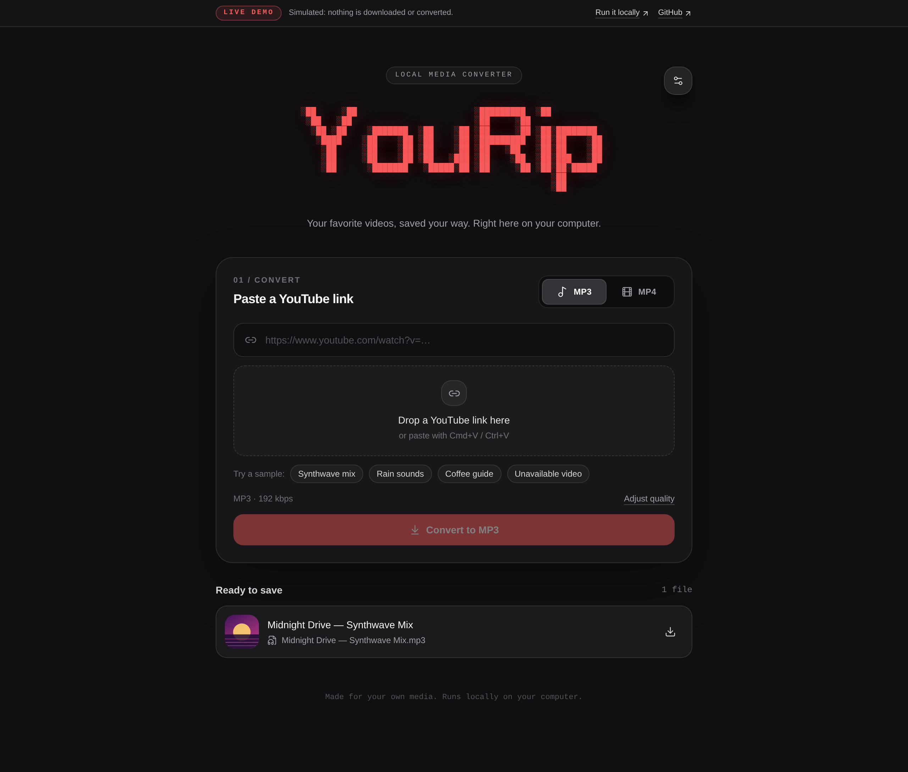
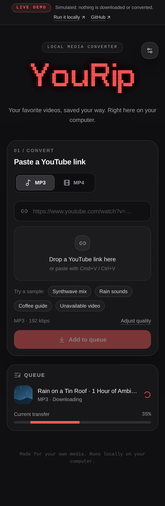

# YouRip

A local web app for saving YouTube videos as MP3 audio or MP4 video. Paste a link, choose a format and quality, watch download progress, and save the finished file from your browser.

**Live demo:** a hosted, *simulated* version of the interface is described in [Live demo](#live-demo). It never downloads, converts, or processes any media.
<!-- After the first Vercel deploy, add a badge here, for example:
[](https://YOUR-PROJECT.vercel.app)
-->



Built with Next.js, React, FastAPI, yt-dlp, and FFmpeg. The interface and converter run on your own computer.

## Quick start

Install the prerequisites for your system (see below), then clone the repository and start it from the repository folder:

```sh
git clone https://github.com/ztxv/yt-media-converter.git
cd yt-media-converter
npm start
```

If you downloaded a ZIP instead, extract it and run `npm start` inside the extracted folder (the one that contains `package.json`).

The launcher creates an isolated Python environment, installs the project dependencies on first launch, and starts both servers. Open **[http://127.0.0.1:3000](http://127.0.0.1:3000)** when the terminal says YouRip is ready. If that port is busy, the launcher selects another available port—use the link printed in your terminal.

Press **Ctrl+C** in that terminal to stop both servers. Future launches use the same command and reuse installed dependencies. An internet connection is required for initial setup and YouTube downloads.

### macOS

Install [Homebrew](https://brew.sh/) if needed, then:

```sh
brew install node python ffmpeg
```

Then follow the Quick start commands above. No Python environment activation or second terminal is required.

### Windows

Install Node.js 22 or newer, Python 3.10 or newer, and FFmpeg. With Windows Package Manager:

```powershell
winget install --id OpenJS.NodeJS.LTS -e
winget install --id Python.Python.3.13 -e
winget install --id Gyan.FFmpeg -e
```

Reopen PowerShell after installation, navigate to the repository folder, and run `npm start`. The launcher supports the Windows Python launcher (`py`) as well as `python`.

### Linux

Install Node.js 22 or newer, Python 3.10 or newer with its `venv` support, and FFmpeg using your distribution's packages or the projects' official installers. Then run `npm start` from the repository folder.

## Features

- Convert a single YouTube video to MP3 or MP4, including short links and Shorts links.
- Choose MP3 bitrate (128, 192, or 320 kbps) or an MP4 resolution cap (480p, 720p, or 1080p).
- See actual transfer progress while yt-dlp downloads each media stream; post-processing shows a separate preparation state.
- Queue up to five waiting videos while a conversion runs.
- Drag links onto the page, or paste into the input and select **Convert**.
- See titles and thumbnails when YouTube metadata is available.
- Enable automatic downloads and choose an accent color in Settings.
- Download recent results again during the current session.

Recent downloads are kept in browser memory, with a limit of ten results and a 300 MB budget for older results. Refreshing the page clears the queue, history, and settings. Playlist downloads and saved libraries are not implemented. Output quality depends on what the source video provides.

## Updating the downloader

YouTube changes regularly. If previously working videos stop converting, stop the app and run:

```sh
npm run update:downloader
npm start
```

This updates yt-dlp and its supporting packages inside the project's Python environment. It does not change your system Python packages.

## Troubleshooting

| Problem | What to do |
| --- | --- |
| `npm` is not found | Install Node.js 22 or newer and reopen the terminal. |
| Python is missing or too old | Install Python 3.10 or newer. On macOS, run `brew install python`. |
| FFmpeg is missing | Install FFmpeg and reopen the terminal so it is available on your PATH. |
| The app opens on a different port | Another app is using the usual port. Open the exact link printed by the launcher. |
| Conversion fails | Read the converter error in the terminal, try a public video, and update the downloader. Private, age-restricted, region-restricted, and sign-in-required videos may not work. |
| A long video fails | Downloads are limited to 250 MB where the source reports its size; conversions time out after ten minutes. Try a shorter video. |
| Dependencies need a fresh install | Stop the app, delete `.venv` and `.local-state` from the repository folder, then run `npm start`. |

## Development

```sh
npm start                  # Install dependencies if needed and run both servers
npm run check              # TypeScript and ESLint checks (after initial setup)
npm test                   # Run converter regression tests (after initial setup)
npm run build              # Verify the frontend production build
npm run update:downloader  # Update the YouTube extraction engine
npm run dev:demo           # Run the simulated demo locally (no backend needed)
npm run build:demo         # Build and verify the static demo (see Live demo)
```

The local launcher binds both services to `127.0.0.1`. Next.js serves the interface on port 3000 and forwards conversion requests to FastAPI on port 8000 by default; occupied ports are skipped automatically. The browser uses the same origin for API calls, so no private IP address or CORS configuration is required.

The backend reports download-job progress, streams the finished MP3 or MP4, and removes its temporary files after delivery. It uses the project's Python environment for yt-dlp and the installed Node.js runtime for YouTube's JavaScript challenges. Fonts are local system fonts, so building the interface does not fetch Google Fonts.

```text
yt-media-converter/
├── scripts/dev.mjs       # Setup, startup, readiness checks, and shutdown
├── yourip-frontend/      # Next.js interface and API forwarding (also builds the demo)
├── yourip-backend/       # FastAPI converter and Python dependencies
├── docs/                 # Demo deployment guide and screenshots
├── package.json          # Commands run from the repository root
└── README.md
```

## Live demo

The demo is the same interface with a simulated converter built into the browser bundle. It shows believable titles and progress for a few sample links, honors the five-item queue, and shows error states, but **no file is ever created** and nothing is downloaded, converted, or sent to YouTube. Pressing Download explains that you need to run YouRip locally.

It is a separate, static build that contains none of the converter: no yt-dlp, FFmpeg, FastAPI backend, or API routes. The build fails if any of those appear in its output. To run or deploy it:

```sh
npm run dev:demo      # local demo with hot reload
npm run build:demo    # static export in yourip-frontend/out, plus a safety check
```

See [docs/vercel-demo.md](docs/vercel-demo.md) for the exact Vercel settings and how the demo is kept separate from the real app.



Use YouRip for content you own or have permission to download.

Interface assets use [Lucide icons](https://lucide.dev/) (ISC), [shadcn/ui components](https://ui.shadcn.com/) (MIT) built on [Radix Primitives](https://www.radix-ui.com/primitives) (MIT), and [Motion for React](https://motion.dev/docs/react) (MIT).
